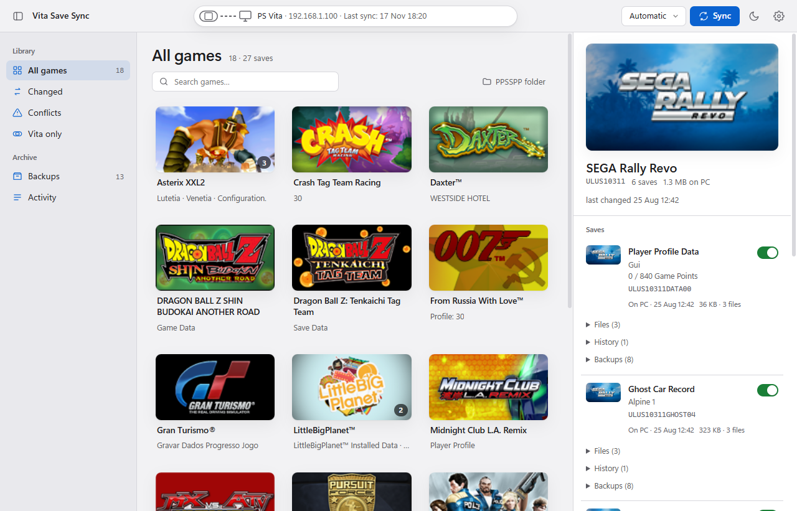
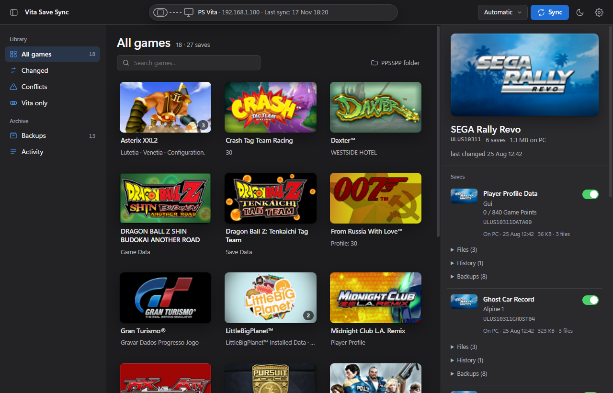
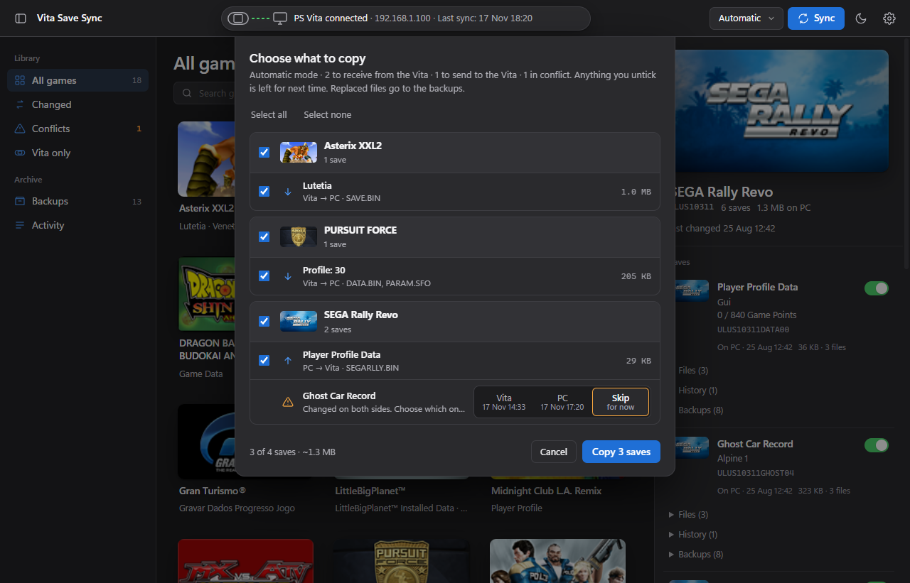
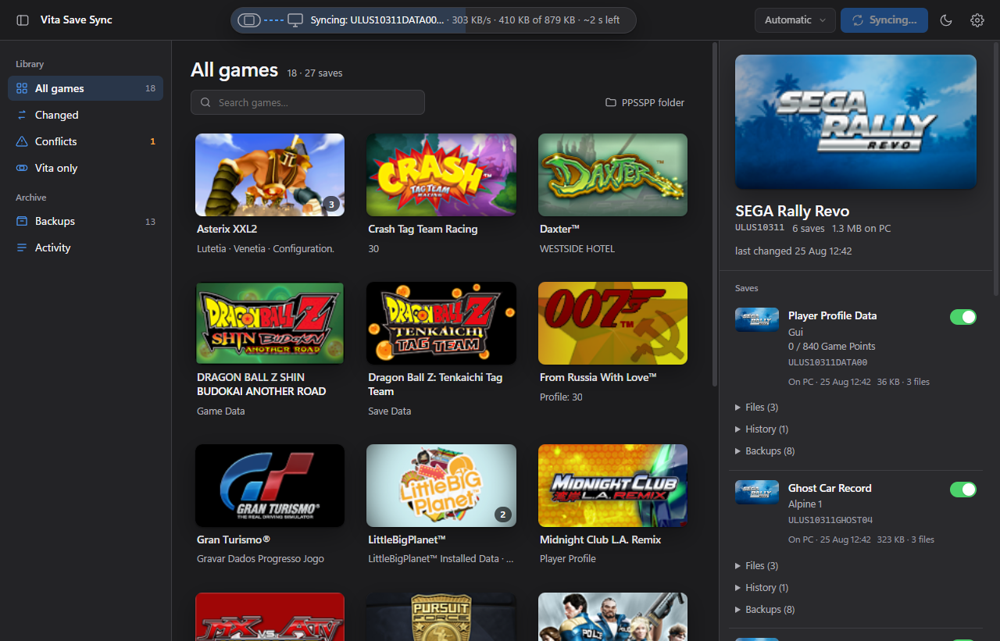
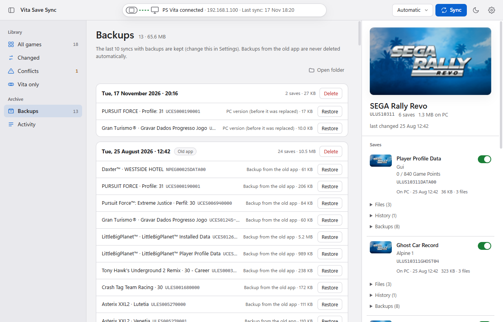

# Vita Save Sync

**Keep your PSP saves in sync between a PS Vita and PPSSPP on Windows.**

Play a PSP game on the Vita, carry on in PPSSPP on your PC, then go back to the Vita. Vita Save Sync copies each save to the side where it's out of date. It connects to the Vita over Wi‑Fi through VitaShell's built-in FTP server, so you don't need a USB cable.



## Features

- **Automatic mode.** The app works out which side you played on and copies saves in that direction. If a save changed on both sides, it asks you instead of guessing.
- **Preview before copying.** Before anything is copied, a sheet lists every save that will be copied and in which direction. You can untick the ones you don't want, and pick Vita, PC or Skip for each conflict.
- **Game library.** Saves are grouped by game, with the real icon and name read from each save's `PARAM.SFO`. Click a game to open it in the inspector next to the library. The inspector shows all its saves, the progress text the game writes (rank, % complete, play time…), files, history and backups.
- **The connection capsule.** The pill at the top shows the link to your Vita. During a sync it turns into the progress bar, with the save being copied, speed and time left. Click it to set the IP, *Test connection* or *Find my Vita*, which scans your local network.
- **Backups.** Every file that gets overwritten is backed up first, and old versions can be restored with one click. Older backups are cleaned up automatically. You choose how many to keep.
- **Light and dark (night mode).** The app follows Windows by default. The moon button switches right away, and Settings has System / Light / Dark.
- You can exclude individual saves, and saves with subfolders are supported.
- It auto-detects the PPSSPP `SAVEDATA` folder (installed or portable version).
- **5 languages:** English, Português, Español, Français and 中文 (Simplified Chinese). The app follows your Windows language by default, and you can change it in Settings.

| Night mode | Choose what to copy |
|:-:|:-:|
|  |  |
| **Sync in progress** | **Backups** |
|  |  |

## Requirements

- Windows 10 or 11.
- A PS Vita with **VitaShell**, running PSP games through **Adrenaline**. PSP saves live in `ux0:pspemu/PSP/SAVEDATA`.
- **PPSSPP** on the PC.
- The Vita and the PC on the same network.

## Getting started

1. Download `Vita Save Sync.exe` from the [latest release](../../releases/latest) and run it. No installation is needed.
   - The first time, Windows SmartScreen may warn that the app is unknown, because it isn't code-signed. Click *More info → Run anyway*.
2. On the Vita, open VitaShell and press **SELECT** to start the FTP server.
3. In the app, click the connection capsule at the top. Then click **Find my Vita**, or type the IP that VitaShell shows, and click **Test connection**.
4. Pick a mode and click **Sync**. Check the preview, then confirm.

### The first sync

On the first sync the app has no history yet, so it can't tell which side is newer when a save differs between the Vita and the PC. Those saves show up as **conflicts**, with the last-modified date of each side. Pick the version you want to keep; the other one goes to the backups.

After that, Automatic mode works on its own.

## How it works

Dates from the Vita can't be trusted. The FTP server only reports times to the minute, and the Vita's clock may use a different time zone. So the app compares file **contents** instead.

After every sync it stores, for each file, a hash of its contents plus the size and date that each side reported (`sync_state.json`). On the next sync, it compares each side with that record:

| What changed since the last sync | What happens |
|---|---|
| Only the PC | The save is sent to the Vita |
| Only the Vita | The save is copied to the PC |
| Both sides | Conflict: nothing is touched until you choose |
| Nothing | Skipped |

A save (`DATA.BIN`, `PARAM.SFO`, icons…) is always copied as a whole, so files from two different versions are never mixed. Deleted files are not propagated: deleting a save on one side does not delete it on the other.

## Running from source

```bash
pip install -r requirements.txt
python PSVitaSaveSync.py
```

`Vita Save Sync.pyw` opens the app without a console window. App data (`config.json`, `sync_state.json`, `history.json`, `app.log`, `cache/`) is stored next to the script or the `.exe`.

### Tests

The tests run the real sync engine against a local fake "Vita" FTP server:

```bash
pip install -r requirements-dev.txt
python tests/test_sync.py
python tests/check_i18n.py
```

### Building the .exe

```bash
pip install -r requirements-dev.txt
tools\build_exe.bat
```

## Project layout

| File | What it does |
|---|---|
| `PSVitaSaveSync.py` | App entry point: the window and the bridge between the UI and Python |
| `sync_engine.py` | Sync logic over FTP, save info (`PARAM.SFO`), PPSSPP detection |
| `backups.py` | Backup listing, restore and cleanup; sync history |
| `vita_net.py` | Connection test and Vita discovery on the local network |
| `ui/index.html` | The whole interface (HTML/CSS/JS, rendered with [pywebview](https://pywebview.flowrl.com/)) |
| `ui/i18n.js` | Translations. To add a language, copy the `en` block and translate it |
| `tests/test_sync.py` | End-to-end tests |
| `tests/check_i18n.py` | Checks that every text exists in every language |

Translation fixes and new languages are welcome. The Python side never writes user-facing text: it sends a key plus parameters, and the UI translates it.

## Disclaimer

This is a fan-made tool, not affiliated with Sony or the PPSSPP project. It always backs up before overwriting anything, but your saves are your responsibility. Keep an extra copy of the ones you care about.

## License

[MIT](LICENSE)
